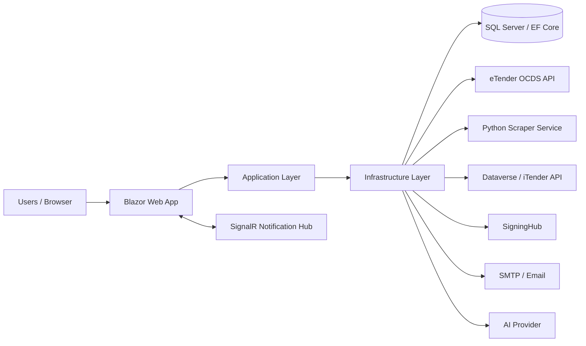

# iTender.Compliance — API & Integration Specification

**Document ID:** ITC-TECH-API-001  
**Version:** 0.1 — Initial technical draft  
**Status:** Draft — technical verification required  
**Repository:** [TebohoMosakoaCIDB/iTender.Compliance](https://github.com/TebohoMosakoaCIDB/iTender.Compliance)  
**Branch reviewed:** `master`  
**Repository revision reviewed:** `eacdf9cf89b311ded41d120fb21e9f128acf8d41` (05 November 2026)  
**Prepared:** 05 November 2026  
**Owner:** CIDB / iTender.Compliance Technical Team

> **Document status:** This draft is based on source files reviewed in the repository revision above. Items marked **To confirm** require validation against the deployed environment, the complete source tree, or the relevant external service owner. No credentials, tokens, connection strings, or secret values are included.

---

## 1. Purpose

This document describes the technical interfaces and integrations implemented by iTender.Compliance. It covers the application entry points, authentication and authorisation, external service clients, data exchange, background processing, and operational behaviour.

It is a technical companion to the business and system documentation maintained by the Business Analyst. It does not replace the approved Business Requirements Specification (BRS), Functional Specification, or business process documentation.

## 2. Scope

### 2.1 Included

- The iTender.Compliance web application and its application, domain, and infrastructure layers.
- The application's mapped web endpoints and SignalR notification hub.
- ASP.NET Core Identity authentication and role-based authorisation.
- SQL Server persistence through Entity Framework Core.
- eTender OCDS release retrieval.
- The eTender scraping service client.
- Dataverse, SigningHub, SMTP/email, and AI-related service registrations.
- Scheduled background processing for synchronisation, assignment, compliance workflows, signing approvals, RoP checks, and scheduled reports.
- Error handling, logging, configuration, and security considerations visible in the reviewed source.

### 2.2 Excluded

- Business rules already documented and approved by the BA.
- A complete field-by-field API contract for external systems where the provider contract or scraper source has not yet been verified.
- Production infrastructure values, credentials, certificates, private keys, and secret configuration.
- A claim that every registered service is enabled or operational in every deployed environment.

## 3. Application technical context

The reviewed solution contains at least the following .NET projects:

| Project | Responsibility evidenced by source |
|---|---|
| `iTender.Compliance.Client` | ASP.NET Core Blazor Web App, interactive server rendering, application startup, Identity configuration and web endpoint mapping. |
| `iTender.Compliance.Application` | Application contracts, DTOs, repository/service interfaces, filters and application services referenced by the other projects. |
| `iTender.Compliance.Domain` | Domain entities and enumerations referenced by application and infrastructure code. |
| `iTender.Compliance.Infrastructure` | EF Core persistence, repositories, external service clients, integrations, background services, document/report generation and dependency registration. |
| `iTender.Compliance.Scrapper` | Python-based scraping service. Its dependency manifest includes FastAPI, Uvicorn, Crawl4AI, Pydantic, BeautifulSoup and LiteLLM. Exact route contracts are **to confirm**. |

The .NET projects target **.NET 10** in the project files reviewed. The Client project uses the ASP.NET Core Web SDK and references the Application, Domain and Infrastructure projects.

### 3.1 High-level interaction view



This is a logical view of integrations evidenced by dependency registrations. Network topology, hosting boundaries, firewall routes and production URLs must be taken from the approved deployment configuration.

## 4. Web application interfaces

### 4.1 Application hosting and rendering

The application is configured with:

- ASP.NET Core Razor Components.
- Interactive Server Components.
- ASP.NET Core authentication and authorisation.
- Static asset mapping.
- HTTPS redirection.
- Antiforgery middleware.
- A production exception handler and HSTS.
- A not-found status-code re-execution route.

### 4.2 Mapped application endpoints

| Interface | Route / mapping | Purpose | Authentication |
|---|---|---|---|
| Blazor application | Razor Components endpoint mapping | Serves the interactive web application. Individual page/component routes are defined in the Client project. | ASP.NET Core Identity cookie authentication and page/policy authorisation. |
| SignalR hub | `/hubs/notifications` | Real-time application notifications. | **To confirm:** verify hub authorisation requirements and connection behaviour in the hub implementation. |
| Identity endpoints | `MapAdditionalIdentityEndpoints()` | Maps the additional ASP.NET Core Identity account endpoints used by the application. | ASP.NET Core Identity. |

The reviewed application startup does not show a conventional controller-based REST API registration or controller route mapping. This does not rule out additional endpoint mappings elsewhere. Confirm whether any API endpoints are exposed by other projects or middleware before publishing a complete endpoint catalogue.

## 5. Authentication and authorisation

### 5.1 Authentication

The Client startup configures ASP.NET Core Identity cookie authentication:

- Default authentication scheme: Identity application scheme.
- Default sign-in scheme: Identity external scheme.
- Identity cookies are enabled.
- Identity users are represented by the application's `ApplicationUser`.
- Identity roles use GUID keys.
- Confirmed accounts are required for sign-in.
- Entity Framework stores are backed by `ComplianceDbContext`.

### 5.2 Roles

The following role constants are referenced in the startup authorisation policies:

- Director
- Compliance Manager
- Compliance Officer
- Compliance Administrator

### 5.3 Authorisation policies

| Policy | Permitted roles in reviewed startup |
|---|---|
| `Administration` | Compliance Administrator, Compliance Manager |
| `CaseAssignment` | Compliance Manager |
| `CaseManagement` | Director, Compliance Manager, Compliance Officer |
| `ComplianceOversight` | Director, Compliance Manager |
| `Reporting` | Director, Compliance Manager, Compliance Officer, Compliance Administrator |
| `AccountManagement` | Compliance Administrator, Compliance Manager |
| `Correspondence` | Director, Compliance Manager, Compliance Officer, Compliance Administrator |
| `CorrespondenceDraft` | Compliance Manager, Compliance Officer |

Page-level use of each policy and any additional record-level/agent-scope checks must be verified against the relevant components and authorisation services.

## 6. Data persistence interface

### 6.1 Database technology

The reviewed Client startup obtains the `DefaultConnection` connection string and configures `ComplianceDbContext` with the Entity Framework Core SQL Server provider.

The project files also reference the PostgreSQL/Npgsql provider. The active provider in the reviewed startup is SQL Server; the presence of the Npgsql package alone does not establish that PostgreSQL is used by the running application.

### 6.2 Entity Framework context

`ComplianceDbContext` derives from `IdentityDbContext<ApplicationUser, IdentityRole<Guid>, Guid>`. The DbSets include:

- Tenders and tender synchronisation records/logs.
- Compliance cases, findings, actions, notes and letters.
- Agents and system settings.
- Audit logs and notifications.
- Correspondence templates and signing requests.
- AGSA referrals and case objections.
- Public holidays.
- Duplicate groups and duplicate candidates.
- Client groups and client-group cases.

Entity configuration is loaded from the Infrastructure assembly using `ApplyConfigurationsFromAssembly`.

A separate Database Design Document and Data Dictionary will provide the full schema, keys, relationships, indexes, constraints and column definitions.

## 7. External integrations

### 7.1 eTender / National Treasury OCDS Release API

**Client:** `EtendersClient`  
**Interface:** HTTP GET  
**Base URL configuration:** `EtendersOptions` section  
**Configured timeout:** 360 seconds  
**Endpoint evidenced in source:** `/api/OCDSReleases`

The client requests release data using the following query parameters:

| Parameter | Description |
|---|---|
| `PageNumber` | Page number to retrieve. |
| `PageSize` | Maximum number of releases requested per page. |
| `dateFrom` | Start date in `yyyy-MM-dd` format. |
| `dateTo` | End date in `yyyy-MM-dd` format. |

Example request shape (host omitted):

```http
GET /api/OCDSReleases?PageNumber=1&PageSize=50&dateFrom=2026-10-01&dateTo=2026-10-31
```

The client deserialises the response into `EtendersResponse`. The all-releases operation starts at page 1, applies the construction-tender filter to the returned releases, and follows the response's `Links.Next` value until no next link is supplied.

**Failure behaviour:** The client checks the HTTP response status and throws an `InvalidOperationException` for unsuccessful responses. The exception text reports that the eTender Release API is currently down and advises retrying later. The current implementation reads the response body but does not include that body in the thrown message; this should be reviewed if detailed provider diagnostics are required.

**To confirm:**
- Current production and non-production base URLs.
- The authoritative provider API specification and authentication requirements, if any.
- Full request/response JSON schemas and pagination semantics.
- Rate limits, availability commitments and retry policy.
- Whether the date range is inclusive at both ends.
- Whether a failed page causes the whole synchronisation to fail or permits partial processing.

### 7.2 eTender scraping service

**Client interface:** `IEtendersScraperClient`  
**Implementation:** `EtendersScraperClient`  
**Configuration section:** `ScraperOptions`  
**Configuration fields evidenced:** `BaseUrl`, `TimeoutSeconds`

A typed HttpClient is registered for the scraper client. The Python scraper project dependency manifest identifies FastAPI and Uvicorn as the web-service framework/runtime, Crawl4AI and BeautifulSoup for scraping-related processing, Pydantic for data models, and LiteLLM for model-provider integration.

The exact HTTP routes, payload schemas, authentication mechanism, response codes, retry rules and operational health endpoint are **to confirm** from the scraper application source and deployed configuration. They are intentionally not invented in this specification.

### 7.3 Dataverse / iTender API

The Infrastructure dependency registration includes `IDataverseService` / `DataverseService` and a CRM service factory (`ICrmServiceFactory` / `CrmServiceFactory`) configured through CRM and encryption options.

The Client startup also registers a typed HttpClient for `IDataverseService` with its base address sourced from `iTenderApi:BaseUrl`. The Infrastructure registration separately registers `IDataverseService` as a scoped service. The effective registration and runtime resolution should be confirmed, because multiple registrations for the same service interface may affect which implementation is resolved.

**To confirm:** whether the application communicates directly with Dataverse, through the iTender API, or uses both paths for different operations; authentication method; entity/table scope; field mappings; and failure/reconciliation behaviour.

### 7.4 SigningHub

The Infrastructure project configures `SigningHubOptions` and registers an HTTP client for `ISigningHubApiProvider` / `SigningHubApiProvider`. The client uses the configured SigningHub base URL and accepts JSON responses.

The application registers document-signing and signing-request services. A hosted service polls for approval outcomes every five minutes after an initial 45-second delay. Completed and rejected letters are passed to correspondence services for completion or rejection handling.

**To confirm:** SigningHub authentication, API routes, request/response schemas, callback or polling contract, signature certificate requirements, and the deployed approval workflow.

### 7.5 SMTP / email

SMTP options are bound from the `SMTP` configuration section and an `IEmailService` implementation (`SmtpEmailService`) is registered. Email is used by correspondence/reminder workflows and scheduled report delivery.

**To confirm:** SMTP host/port/TLS settings, sender identity, authentication mechanism, delivery limits, bounce handling and production relay policy. Secret values must remain in the approved secret store and must not be committed to source control.

### 7.6 AI provider

The Infrastructure registration binds `OpenAIOptions` and registers `ITenderDiscoveryAgent` / `TenderDiscoveryAgent`. The Python scraper dependency manifest also includes LiteLLM.

The precise AI provider, model, prompts, data sent to the provider, retention controls and fallback behaviour must be verified from the implementation and approved configuration before being documented as a production data flow.

## 8. Background processing and scheduled integrations

The following hosted services are registered in Infrastructure. The intervals below are taken from the reviewed service implementations and should be checked against production settings and actual hosting behaviour.

| Hosted service | Behaviour / schedule evidenced |
|---|---|
| `TenderSyncBackgroundService` | Waits 12 hours before its first automatic run, then runs tender synchronisation every 12 hours. |
| `AutoAssignmentBackgroundService` | Runs unassigned-case assignment every 12 hours using a `PeriodicTimer`. |
| `RoPComplianceBackgroundService` | Runs the unregistered-award / Register of Projects compliance process, then waits one day. |
| `ComplianceWorkflowBackgroundService` | Waits 60 seconds at startup; processes reminders, escalation and SLA warnings; then waits the configured `ReminderCheckIntervalMinutes`, defaulting to 60 minutes if not set. |
| `SigningApprovalBackgroundService` | Waits 45 seconds at startup and polls SigningHub every 5 minutes. |
| `MonthlyReportBackgroundService` | Checks hourly. Monthly reports are considered on the first day of the month; quarterly reports on 1 January, 1 April, 1 July and 1 October. Configured UTC send hours and recipient settings apply. |

### 8.1 Operational considerations

- These jobs run within the ASP.NET Core host process. They therefore depend on the application instance being running.
- Confirm whether production runs more than one application instance. If it does, assess distributed locking, leader election or idempotency to prevent duplicate scheduled work.
- Confirm the configured application timezone and distinguish UTC-based report scheduling from local business-time expectations.
- Confirm whether the first-run delays are acceptable after deployments and application restarts.
- Monitor job duration, last successful execution, failures and processed record counts.
- Confirm that cancellation tokens and host shutdown behaviour are respected for all long-running integrations.

## 9. Synchronisation and processing overview

The source reviewed evidences these integration and processing paths:

1. Tender synchronisation retrieves eTender release data through the OCDS client.
2. The all-releases client follows provider pagination links and filters releases to construction tenders.
3. The application also registers a separate scraper client, with a configurable base URL and timeout.
4. Tender synchronisation and compliance processing are exposed through application service interfaces and repositories.
5. Scheduled compliance processing handles reminders, escalation and SLA warnings.
6. RoP compliance processing checks awarded tenders that have not been registered on the Register of Projects.
7. Signing approval polling updates correspondence processing when signing requests are completed or rejected.
8. Scheduled monthly and quarterly report processes generate report output and email it to configured recipients.

Detailed field-level mapping, duplicate resolution, transaction boundaries, idempotency rules and reconciliation steps require review of the relevant mapper, synchronisation and processing service implementations. These details will be expanded once verified.

## 10. Error handling, logging and audit

The reviewed code uses Microsoft.Extensions.Logging in hosted services. Background services log failures for tender synchronisation, RoP checks, compliance workflow, SigningHub polling and scheduled reports. The Infrastructure layer registers audit-log repositories and an audit service.

The eTender client checks unsuccessful HTTP status codes and raises an exception. The Client host uses a production exception handler and HSTS; development uses the migrations endpoint.

**To confirm and document in the operations guide:**
- Central log destination, retention, access and alerting.
- Correlation IDs or trace IDs across application and external service calls.
- Audit events captured for user actions, case changes, correspondence and integrations.
- Retry/backoff policy for each external integration.
- Dead-letter or failed-record recovery procedures.
- Monitoring thresholds and escalation ownership.

## 11. Configuration and secrets

The following configuration sections/keys are referenced by the reviewed source:

| Configuration key / section | Purpose |
|---|---|
| Connection string `DefaultConnection` | EF Core database connection. |
| `iTenderApi:BaseUrl` | Base address for the registered iTender API HTTP client. |
| `CRM` / `CrmOptions` | CRM service configuration. |
| `Encryption` / `EncryptionOptions` | Encryption-related configuration. |
| `Scraper` / `ScraperOptions` | Scraper service base URL and timeout. |
| `Etenders` / `EtendersOptions` | eTender OCDS API base URL. |
| `SigningHub` / `SigningHubOptions` | SigningHub API configuration. |
| `SMTP` / `SmtpOptions` | Email transport configuration. |
| `ETenderApi` / `ETenderApiOptions` | Additional eTender API configuration registered by Infrastructure. |
| `OpenAI` / `OpenAIOptions` | AI provider configuration. |

Actual values must be maintained per environment. Passwords, API keys, tokens, encryption keys, certificates and connection strings must be stored in a secure configuration provider (for example, the organisation-approved secret store), not in this document or committed source files.

## 12. Security considerations

- Enforce HTTPS in hosted environments.
- Keep production exception details out of end-user responses.
- Protect Identity cookies and review cookie security settings for the deployed TLS configuration.
- Ensure antiforgery protection remains enabled for state-changing browser requests.
- Apply the documented authorisation policies and record-level checks to all relevant pages and operations.
- Restrict access to integration credentials and signing material.
- Avoid logging credentials, tokens, personal information or full sensitive payloads.
- Review data-sharing and retention requirements before sending tender, contractor or case data to external AI services.
- Ensure the SignalR hub is protected consistently with the notification data it exposes.

## 13. Dependencies evidenced in project files

The reviewed project files include .NET 10 / EF Core 10 packages, ASP.NET Core Identity, SQL Server and Npgsql EF Core providers, Dataverse Client, SignalR, ClosedXML, Open XML, QuestPDF, OpenAI, HtmlAgilityPack and HTTP client/configuration packages. The scraper requirements include FastAPI, Uvicorn, Crawl4AI, Pydantic, BeautifulSoup and LiteLLM.

This is not a full software bill of materials. A separate dependency/security review should record exact transitive dependencies, versions, vulnerability status and licence obligations.

## 14. Outstanding technical verification

The following items must be closed before this document is marked Approved:

1. Obtain the complete scraper source and document its exact routes, authentication and JSON schemas.
2. Confirm whether the application exposes any REST API routes beyond the mappings visible in Client startup.
3. Confirm the effective Dataverse/iTender API service registration and the actual data access path.
4. Obtain the provider-approved eTender OCDS API contract, including authentication, pagination, rate limits and date semantics.
5. Verify SigningHub authentication, routes, signature lifecycle and callback/polling behaviour.
6. Verify SMTP transport and secret management in each environment.
7. Confirm AI provider/model usage and the data sent to external AI services.
8. Verify all background job intervals, timezone assumptions and multi-instance behaviour in production.
9. Document end-to-end data mappings, deduplication, reconciliation, retry and recovery behaviour.
10. Confirm log, audit, monitoring, alerting and retention arrangements.

## 15. Source references reviewed

The following repository files were used to prepare this draft:

- `iTender.Compliance.Client/Program.cs`
- `iTender.Compliance.Client/iTender.Compliance.Client.csproj`
- `iTender.Compliance.Infrastructure/Extensions/ServiceCollectionExtensions.cs`
- `iTender.Compliance.Infrastructure/Data/ComplianceDbContext.cs`
- `iTender.Compliance.Infrastructure/Data/SystemSettingSeeder.cs`
- `iTender.Compliance.Infrastructure/Services/EtendersClient.cs`
- `iTender.Compliance.Infrastructure/Services/BackgroundServices/TenderSyncBackgroundService.cs`
- `iTender.Compliance.Infrastructure/Services/BackgroundServices/AutoAssignmentBackgroundService.cs`
- `iTender.Compliance.Infrastructure/Services/BackgroundServices/RoPComplianceBackgroundService.cs`
- `iTender.Compliance.Infrastructure/Services/BackgroundServices/ComplianceWorkflowBackgroundService.cs`
- `iTender.Compliance.Infrastructure/Services/BackgroundServices/SigningApprovalBackgroundService.cs`
- `iTender.Compliance.Infrastructure/Services/BackgroundServices/MonthlyReportBackgroundService.cs`
- `iTender.Compliance.Infrastructure/Services/DocumentService.cs`
- `iTender.Compliance.Infrastructure/iTender.Compliance.Infrastructure.csproj`
- `iTender.Compliance.Scrapper/requirements.txt`

## 16. Document approval

| Role | Name | Signature | Date |
|---|---|---|---|
| Prepared by | Technical Team |  |  |
| Reviewed by | Technical Lead |  |  |
| Reviewed by | System Owner |  |  |
| Approved by | Authorised Approver |  |  |

---

**End of document**
