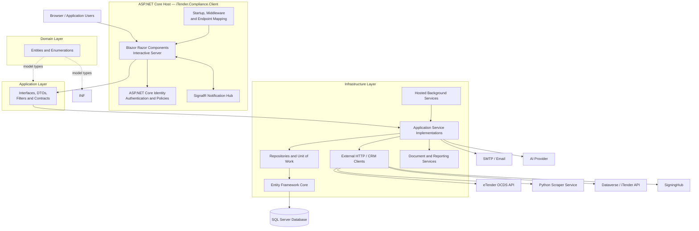
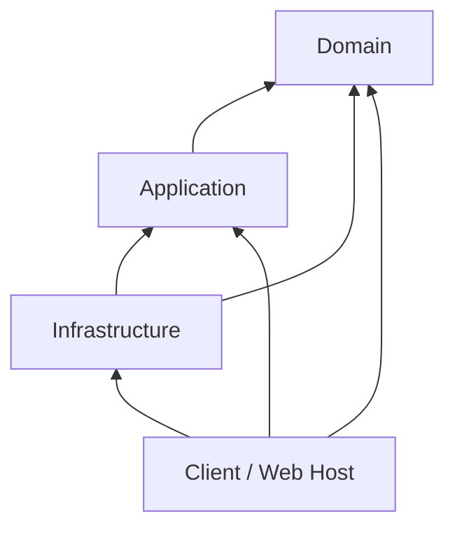

# iTender.Compliance — System Architecture Document

**Document ID:** ITC-TECH-SAD-001  
**Version:** 0.1 — Initial technical draft  
**Status:** Draft — architecture and deployment verification required  
**Repository:** [TebohoMosakoaCIDB/iTender.Compliance](https://github.com/TebohoMosakoaCIDB/iTender.Compliance)  
**Branch reviewed:** `master`  
**Repository revision reviewed:** `e6f14548d8e4741f570f686309d499ae1bcc7eab` (05 November 2026)  
**Prepared:** 05 November 2026  
**Owner:** CIDB / iTender.Compliance Technical Team

> **Document status:** This document describes the architecture evidenced by the source files reviewed at the repository revision above. It is not an infrastructure deployment diagram. Items marked **To confirm** require validation against the deployed environments, full source tree, or technical owners. The BA's approved business and system documentation remains the source of truth for business requirements and process definitions.

---

## 1. Purpose

This System Architecture Document (SAD) describes the technical structure of iTender.Compliance: its application layers, project boundaries, runtime components, persistence, integration points, security mechanisms and background processing.

It is intended for developers, technical leads, solution architects, infrastructure teams, security reviewers and maintainers. It complements the BA's system and business documentation and the separate API & Integration Specification.

## 2. Architectural overview

The reviewed implementation is a .NET 10 ASP.NET Core Blazor Web App with an application/domain/infrastructure project structure. The web application uses Interactive Server Components, ASP.NET Core Identity, Entity Framework Core and SQL Server configuration. Infrastructure provides repositories, application services, integration clients, reporting/document services and hosted background services.

A separate Python project, `iTender.Compliance.Scrapper`, contains the dependencies for a FastAPI-based scraping service. The .NET infrastructure registers an HTTP client for that service.

### 2.1 Architecture style

The source structure follows a layered architecture:

- **Presentation layer:** Blazor Web App and its Razor Components.
- **Application layer:** application-facing interfaces, DTOs, filters and service contracts.
- **Domain layer:** business entities and enumerations.
- **Infrastructure layer:** persistence, repositories, service implementations, external integrations, document/report generation and background services.

The layers are separated into projects, but the exact enforcement of dependency rules should be verified through project references and namespace usage. The Client project references Application, Domain and Infrastructure. Infrastructure references Application and Domain. Application references Domain.

### 2.2 Logical architecture

The diagram is logical, not a network topology. It illustrates responsibilities and known communication paths; it does not establish that every integration is called by every workflow or that all components run on separate servers.

## 3. Solution and project structure

The reviewed solution contains the following principal projects:

| Project | Type | Architectural responsibility |
|---|---|---|
| `iTender.Compliance.Client` | ASP.NET Core Web project | Application host, Blazor UI, Identity setup, middleware, endpoint mapping, startup seeding and database provider configuration. |
| `iTender.Compliance.Application` | .NET class library | Application contracts, interfaces, DTOs, filters and service abstractions used by presentation and infrastructure. |
| `iTender.Compliance.Domain` | .NET class library | Domain entities and enumerations. |
| `iTender.Compliance.Infrastructure` | .NET class library | EF Core context, repository implementations, application service implementations, integration clients, hosted services, identity support, document generation and reporting. |
| `iTender.Compliance.Scrapper` | Python service project | Scraping-service code/dependencies. The requirements file includes FastAPI, Uvicorn, Crawl4AI, Pydantic, BeautifulSoup and LiteLLM. |

All reviewed .NET project files target `.NET 10`. The scraper's Python runtime version and deployment packaging are **to confirm**.

### 3.1 Project dependency direction

The arrows indicate project references (the referencing project depends on the referenced project). The Client directly references Infrastructure to compose the application at startup. This is a pragmatic layered structure; it is not a strict dependency-inversion-only architecture because the presentation host references the Infrastructure project directly.

## 4. Presentation and runtime host

### 4.1 Blazor Web App

The Client project uses the ASP.NET Core Web SDK and configures Razor Components with Interactive Server Components. The application is hosted by ASP.NET Core and maps the root Razor component through `MapRazorComponents<App>()`.

The reviewed startup configures:

- HTTP context access.
- Razor Components with Interactive Server rendering.
- Cascading authentication state.
- Identity redirect management and authentication-state revalidation.
- ASP.NET Core Identity cookies.
- Role-based authorisation policies.
- HTTPS redirection and antiforgery middleware.
- Static asset mapping.
- SignalR notification hub mapping.
- Additional Identity endpoints.

### 4.2 Middleware and endpoint pipeline

The reviewed startup applies the following environment-dependent behaviour:

- Development: migrations endpoint middleware is enabled.
- Non-development: exception handler at `/Error` and HSTS are enabled.
- Status-code pages re-execute through `/not-found`.
- HTTPS redirection is enabled.
- Antiforgery middleware is enabled.
- Static assets and Razor Components endpoints are mapped.
- The notification hub is mapped at `/hubs/notifications`.
- Additional Identity endpoints are mapped.

**To confirm:** deployed reverse proxy/load balancer configuration, forwarded headers, TLS termination, health checks, static-file/CDN strategy and production exception handling details.

### 4.3 API boundary

The reviewed Client startup maps the Blazor application, SignalR hub and Identity endpoints. It does not show conventional MVC controller registration or controller route mapping. Therefore, this document does not describe the application as a public REST API without further evidence.

The eTender OCDS endpoint is an external provider endpoint consumed by the application; it is not an internal iTender.Compliance endpoint.

**To confirm:** inspect all projects and hosting configuration for minimal API routes, endpoint route groups, additional services or separately deployed API applications.

## 5. Application layer

The Application project references Domain and contains application-facing contracts, DTOs, filters, service interfaces and repository interfaces. Infrastructure implements these abstractions.

The intended responsibility of this layer is to define the operations the application requires without embedding infrastructure-specific details such as database provider configuration or HTTP transport.

Examples of application contracts evidenced by the Infrastructure registrations include tender, compliance, synchronisation, reporting, audit, assignment, correspondence, notification, document signing, escalation, reminder, objection, work-basket and client-group services.

**To confirm:** produce a complete interface-to-implementation inventory and identify any application services that currently contain implementation logic rather than contracts.

## 6. Domain layer

The Domain project is a .NET class library referenced by Application and Infrastructure. The EF Core context exposes domain entities including:

- Tender
- ComplianceCase
- Agent
- CaseLetter
- CaseNote
- ComplianceFinding
- TenderSync
- AuditLog
- SystemSetting
- TenderSyncLog
- Notification
- CorrespondenceTemplateModel
- SigningRequest
- AGSAReferral
- CaseObjection
- PublicHoliday
- ComplianceAction
- DuplicateGroup
- DuplicateCandidate
- ClientGroup
- ClientGroupCase

The context applies entity configurations from the Infrastructure assembly. This means entity configuration is currently located with Infrastructure rather than exclusively in the Domain project.

A separate Database Design Document and Data Dictionary will document schema details, relationships and constraints.

## 7. Infrastructure layer

The Infrastructure project implements the technical capabilities used by the application. Its responsibilities evidenced in source include:

### 7.1 Persistence and repositories

- `ComplianceDbContext` and EF Core entity configuration.
- Identity persistence through EF Core stores.
- Repository implementations for tenders, compliance cases, correspondence, agents, audit, notifications, synchronisation, reporting, duplicate detection and related records.
- Unit of Work registration.
- Database seeders for Identity, agents, correspondence templates, public holidays and system settings.

Repository implementations use `IDbContextFactory<ComplianceDbContext>` through a common repository base in the reviewed source.

### 7.2 Application services

Infrastructure registers services for compliance processing, synchronisation, reporting, case authorisation, assignment, escalation, reminders, correspondence, document signing, duplicate detection/verification, tender classification, client groups, work baskets and officer scope, among others.

The complete service catalogue should be maintained with the relevant API/integration and operations documentation.

### 7.3 Document and report generation

The Infrastructure project references QuestPDF, ClosedXML and Open XML packages. Source files include document and PDF/Excel reporting services. The project also references HTML parsing support.

The QuestPDF licence is configured in the Infrastructure service registration. The current source sets `LicenseType.Evaluation`; confirm the organisation's approved licence and deployment compliance before production use.

## 8. Data architecture

### 8.1 Database provider

The reviewed Client startup obtains the `DefaultConnection` connection string and configures `ComplianceDbContext` through `UseSqlServer`. This establishes SQL Server as the configured provider in that startup path.

The project files also reference the Npgsql EF Core provider. That package reference does not, by itself, establish that PostgreSQL is used at runtime. Confirm whether Npgsql is retained for a separate environment, migration history or legacy reason, or can be removed.

### 8.2 Identity and application data

`ComplianceDbContext` derives from `IdentityDbContext<ApplicationUser, IdentityRole<Guid>, Guid>`, so ASP.NET Core Identity tables are managed through the same EF Core context as the application data.

### 8.3 Context lifecycle

The Client startup registers `AddDbContextFactory<ComplianceDbContext>`. Repository code uses the context factory to create contexts. This supports explicit context creation for repository operations and background processing.

### 8.4 Database migration and startup seeding

The reviewed startup creates a scope, obtains the context factory, creates a context and invokes seeders for Identity, agents, correspondence templates, public holidays and system settings.

**To confirm:** production migration strategy, whether migrations run during deployment or startup, database backup/restore procedures, connection pooling settings, retry-on-failure configuration, encryption at rest and database high availability.

## 9. Integration architecture

The following external systems and capabilities are registered in the reviewed Infrastructure code:

| Integration | Technical mechanism evidenced | Architectural role |
|---|---|---|
| eTender OCDS Release API | Typed HttpClient / `IEtendersClient` | Retrieves paginated release data from the configured provider base URL. |
| eTender scraper | Typed HttpClient / `IEtendersScraperClient` | Calls the separately configured scraper service. |
| Dataverse / iTender API | CRM service factory and Dataverse service registrations; Client also registers a typed HttpClient for `IDataverseService` | Provides access to CRM/Dataverse or iTender API capabilities. The effective path requires verification. |
| SigningHub | Typed HttpClient / `ISigningHubApiProvider` | Supports document-signing and approval processing. |
| SMTP | `IEmailService` / `SmtpEmailService` | Sends correspondence, reminders and scheduled report emails. |
| AI provider | `ITenderDiscoveryAgent`, OpenAI options; scraper includes LiteLLM | Supports AI-assisted tender discovery/classification functionality. Exact live provider and data flow require verification. |
| TenderFlow | Named HttpClient | HTTP client registration with a browser-style User-Agent; the associated scraper service registration is commented out in the reviewed source. |

The detailed request/response contracts, data mappings, credentials model, failure behaviour and integration schedules are maintained in the API & Integration Specification.

### 9.1 Integration boundary principle

External systems should be accessed through the Infrastructure layer's typed clients, provider abstractions or service interfaces. Application and presentation components should depend on application-level abstractions rather than constructing raw external HTTP requests.

**To confirm:** review actual call sites to validate this boundary consistently and identify any direct HTTP calls from UI components or application services.

## 10. Background processing architecture

Infrastructure registers the following hosted services:

- `TenderSyncBackgroundService`
- `AutoAssignmentBackgroundService`
- `RoPComplianceBackgroundService`
- `ComplianceWorkflowBackgroundService`
- `SigningApprovalBackgroundService`
- `MonthlyReportBackgroundService`

They are registered through ASP.NET Core dependency injection using `AddHostedService`. This indicates that they execute within the web application's host process rather than in a separately evidenced worker host.

The individual schedules and processing responsibilities are documented in the API & Integration Specification and Maintenance & Operations Guide.

### 10.1 Hosting implications

- Background work is coupled to the lifecycle and availability of the web host.
- Application restarts can interrupt in-progress work unless operations are resumable or safely repeatable.
- Multiple web instances may execute the same hosted service unless coordination is implemented.
- Long-running work must observe cancellation and shutdown signals.
- Job outcomes should be observable through logs, metrics, status records and alerts.

**To confirm:** production instance count, distributed coordination, job persistence, concurrency controls, idempotency and recovery of interrupted jobs. Consider a separate worker process if workload isolation, independent scaling or stronger job durability is required.

## 11. Security architecture

### 11.1 Authentication

The Client startup configures ASP.NET Core Identity cookie authentication, Identity user stores backed by `ComplianceDbContext`, and confirmed-account sign-in requirements.

### 11.2 Authorisation

Role-based policies are defined in startup for administration, case assignment, case management, compliance oversight, reporting, account management, correspondence and correspondence drafting.

The roles referenced include Director, Compliance Manager, Compliance Officer and Compliance Administrator.

### 11.3 Transport and request protection

The reviewed startup enables HTTPS redirection, antiforgery middleware, HSTS in non-development environments and a production exception handler.

### 11.4 Integration secrets

CRM, encryption, scraper, eTender, SigningHub, SMTP and AI configuration are bound through options/configuration sections. Actual secret storage and rotation arrangements are not established by the source files reviewed.

**To confirm:** secret store, managed identity/service principal use, key rotation, cookie settings, session expiration, MFA requirements, role provisioning, data classification, audit retention and security monitoring.

## 12. Configuration and environment architecture

Configuration is read through ASP.NET Core configuration and options binding. The reviewed source references settings for:

- Default database connection.
- iTender API base URL.
- CRM and encryption.
- Scraper.
- eTender OCDS.
- SigningHub.
- SMTP.
- Additional eTender API options.
- OpenAI options.

The same application should be deployable to separate environments using environment-specific configuration, without embedding secrets or environment URLs in source code.

**To confirm:** actual environment names (for example Development, Test/UAT and Production), app settings strategy, secret provider, deployment variables, configuration validation and differences between environments.

## 13. Observability and operational architecture

Infrastructure hosted services use Microsoft.Extensions.Logging. Audit-log repository/service registrations are present. The application uses the ASP.NET Core exception handler outside development.

The architecture document does not establish the deployed log aggregation, application performance monitoring, alerting, health-check endpoints or operational dashboards.

**To confirm:** log destination and retention; Application Insights or equivalent; distributed tracing; correlation IDs; health/readiness probes; availability alerts; database monitoring; job execution metrics; and support escalation procedures.

## 14. Deployment architecture

The repository evidences an ASP.NET Core web host and a separate Python scraper project. It does not, by itself, establish the production hosting topology.

The following deployment details must be completed with the infrastructure team:

| Deployment concern | Required confirmation |
|---|---|
| Web hosting | Azure App Service, VM, container platform or other hosting target; plan/tier and instance count. |
| Python scraper hosting | Hosting target, runtime version, container/process model, scaling and health checks. |
| Database | SQL Server hosting target, network access, backup policy, HA/DR and encryption. |
| Network | VNet/private endpoints, firewall rules, outbound access and DNS. |
| TLS | Certificate ownership, termination point and renewal. |
| Secrets | Key Vault or approved secret-management platform, identities and access policy. |
| CI/CD | Build pipeline, test gates, deployment stages, approvals and rollback. |
| Storage | Document/report storage location, persistence, retention and access controls. |

Do not infer that the web host and scraper share a process or server. Their deployment relationship is to confirm.

## 15. Architecture decisions and risks to review

| Topic | Current evidence | Review / decision required |
|---|---|---|
| Layered solution | Client, Application, Domain and Infrastructure projects with the references described above. | Confirm dependency rules and prevent UI-to-database implementation leakage. |
| Database provider | Client startup uses SQL Server; Npgsql package is also referenced. | Confirm whether PostgreSQL support is still required. |
| API exposure | Blazor, SignalR and Identity endpoint mappings are visible; no controller mapping in reviewed startup. | Confirm complete route inventory and whether a separate API exists. |
| Hosted jobs | Six hosted services run in the web host. | Assess duplicate execution, resilience, durable scheduling and independent scaling. |
| Dataverse registration | Dataverse service is registered in Infrastructure and as a typed HttpClient in Client. | Verify effective DI resolution and remove ambiguity if unintended. |
| QuestPDF licence | Source sets Evaluation licence. | Confirm approved production licence and terms. |
| Scraper | Separate Python project and .NET typed client. | Verify runtime, contract, hosting, authentication and monitoring. |
| AI integration | OpenAI options and tender discovery agent are registered; LiteLLM is in scraper dependencies. | Confirm actual provider, model, data flow and governance. |

## 16. Related technical documents

This SAD is part of the iTender.Compliance technical documentation set:

1. API & Integration Specification.
2. System Architecture Document (this document).
3. Database Design Document.
4. Data Dictionary.
5. Security & Access Control Specification.
6. Configuration & Environment Specification.
7. Deployment & Installation Guide.
8. Testing & QA Technical Document.
9. Maintenance & Operations Guide.
10. Backup & Disaster Recovery Plan.

The BA's system overview, business requirements and functional/process documentation remain separate source documents.

## 17. Source references reviewed

- `iTender.Compliance.Client/Program.cs`
- `iTender.Compliance.Client/iTender.Compliance.Client.csproj`
- `iTender.Compliance.Application/iTender.Compliance.Application.csproj`
- `iTender.Compliance.Domain/iTender.Compliance.Domain.csproj`
- `iTender.Compliance.Infrastructure/iTender.Compliance.Infrastructure.csproj`
- `iTender.Compliance.Infrastructure/Extensions/ServiceCollectionExtensions.cs`
- `iTender.Compliance.Infrastructure/Data/ComplianceDbContext.cs`
- `iTender.Compliance.Infrastructure/Services/EtendersClient.cs`
- `iTender.Compliance.Scrapper/requirements.txt`

## 18. Document approval

| Role | Name | Signature | Date |
|---|---|---|---|
| Prepared by | Technical Team |  |  |
| Reviewed by | Technical Lead |  |  |
| Reviewed by | System Owner |  |  |
| Approved by | Authorised Approver |  |  |

---

**End of document**
