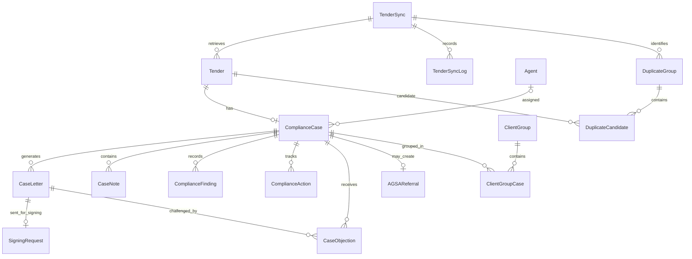

# 03 – Database Design Document

## Document control

| Item | Value |
|---|---|
| System | iTender Compliance |
| Document | Database Design Document |
| Version | 1.0 – source-derived draft |
| Database technology | Microsoft SQL Server (current EF Core model) |
| ORM | Entity Framework Core 10 |
| Context | `ComplianceDbContext` |
| Source baseline | Repository default branch at the time of preparation |

> **Status:** This document describes the database model represented by the current source code and EF Core model snapshot. It is not a substitute for inspecting the deployed database. Confirm the deployed schema, migration history, retention rules, and operational database settings before treating this as the production as-built record.

## 1. Purpose and scope

This document describes the persistence model for iTender Compliance: its principal data areas, entity/table inventory, key relationships, identity data, constraints, and database implementation conventions.

It covers the application-owned EF Core model. External systems such as eTender/OCDS, Dataverse/iTender, SigningHub, email services, and scraper sources are integration endpoints; they are not assumed to be tables in this database unless represented by an entity below.

## 2. Database technology and access

### 2.1 Provider and context

The Client startup registers `ComplianceDbContext` using Entity Framework Core's SQL Server provider and the `DefaultConnection` connection string:

- Startup: `iTender.Compliance.Client/Program.cs`
- Context: `iTender.Compliance.Infrastructure/Data/ComplianceDbContext.cs`
- Entity configurations: `iTender.Compliance.Infrastructure/Data/Configurations/`
- Migrations and model snapshot: `iTender.Compliance.Infrastructure/Migrations/`

The context derives from:

```csharp
IdentityDbContext<ApplicationUser, IdentityRole<Guid>, Guid>
```

The model therefore includes both business entities and ASP.NET Core Identity entities. The EF Core model snapshot uses SQL Server types such as `uniqueidentifier`, `nvarchar`, `datetime2`, and SQL Server identity columns.

The project may contain references to other database packages; those references alone do not establish the active runtime provider. The current Client registration and migration snapshot indicate SQL Server.

### 2.2 Context registration and use

The application registers an `IDbContextFactory<ComplianceDbContext>`. Repository implementations use the factory through `RepositoryBase`. This is important for Blazor Server workloads, where a long-lived circuit should not retain a single EF Core context indefinitely.

### 2.3 Naming

The context exposes DbSet properties for the principal application entities. Explicit table names are configured for several entities; other table names follow EF Core conventions or the model snapshot. The physical database table names should be confirmed against the deployed database.

## 3. Conceptual data domains

The database can be understood as the following functional areas:

1. **Tender intake and synchronization** – tenders, sync runs, sync logs, duplicate review.
2. **Compliance case management** – cases, findings, actions, notes, letters, objections, referrals and audit history.
3. **Work allocation and client grouping** – agents, employer/client groups and group-to-case associations.
4. **Correspondence and signing** – correspondence templates, generated case letters and signing requests.
5. **System operations** – settings, notifications and public holidays.
6. **User identity and access** – application users, roles, claims, logins, tokens and related ASP.NET Core Identity records.

## 4. Entity and table inventory

The following application entities are exposed by `ComplianceDbContext`.

| Entity / DbSet | Purpose |
|---|---|
| `Tender` / `Tenders` | Stores tender information ingested from configured sources, including source identifiers, dates, employer, classification, award and RoP-related fields. |
| `TenderSync` / `TenderSyncs` | Records a tender synchronisation run, its status, totals, start/completion times and initiating user. |
| `TenderSyncLog` / `SyncLogs` | Stores messages and diagnostics associated with a sync run, including severity/type and optional tender number. |
| `ComplianceCase` / `ComplianceCases` | Represents the compliance case associated with a tender, including status, outcome, priority, assigned agent, closure and deadline-extension information. |
| `Agent` / `Agents` | Stores compliance officer/agent profile, allocation settings, workload limits and presentation/signature metadata. |
| `ComplianceFinding` / `ComplianceFindings` | Records an individual compliance finding, stream, finding type, regulatory reference, verification/resolution state and tender status at check time. |
| `ComplianceAction` / `ComplianceActions` | Records an action in a compliance case, its type, status, action date, due/completion dates and comments. |
| `CaseLetter` / `CaseLetters` | Stores correspondence metadata, recipient, letter type/number, document location, email state, response due date and response outcome. |
| `CaseNote` / `Notes` | Stores user-entered notes/comments associated with a compliance case. |
| `AuditLog` / `AuditLogs` | Stores audit events using action/entity classifications, entity identifier and description. |
| `CaseObjection` / `CaseObjections` | Records objections against a case and letter, including review and decision information. |
| `AGSAReferral` / `AGSAReferrals` | Stores enforcement referral details and subsequent response information. |
| `SigningRequest` / `SigningRequests` | Tracks a letter's signing workflow, SigningHub identifiers, signer details, file paths and status. |
| `CorrespondenceTemplateModel` / `CorrespondenceTemplates` | Stores versioned correspondence templates, approval metadata, subject and body. |
| `ClientGroup` / `ClientGroups` | Groups cases by normalized employer identity and stores consolidated correspondence and allocation details. |
| `ClientGroupCase` / `ClientGroupCases` | Join entity associating a client group with a compliance case; includes the date added. |
| `DuplicateGroup` / `DuplicateGroups` | Represents a duplicate-review group created during a tender sync. |
| `DuplicateCandidate` / `DuplicateCandidates` | Links a candidate tender to a duplicate group with match type and confidence score. |
| `Notification` / `Notifications` | Stores user-targeted or general notifications, read state, type, message and optional navigation URL. |
| `SystemSetting` / `SystemSettings` | Stores operational and workflow settings, including response windows, reminders, allocation, SLA and scheduled report settings. |
| `PublicHoliday` / `PublicHolidays` | Stores public holiday dates and observed-shift information used for working-day calculations. |

### 4.1 ASP.NET Core Identity tables

Because the context inherits from `IdentityDbContext<ApplicationUser, IdentityRole<Guid>, Guid>`, the model also includes the standard Identity tables. These include:

- `AspNetUsers` – application users, extended by `ApplicationUser`.
- `AspNetRoles` – role definitions.
- `AspNetUserRoles` – user-to-role membership.
- `AspNetUserClaims` and `AspNetRoleClaims` – user and role claims.
- `AspNetUserLogins` – external login provider associations.
- `AspNetUserTokens` – authentication tokens.
- `AspNetUserPasskeys` – passkey credentials, where supported by the configured Identity version.

The custom `ApplicationUser` adds `FirstName`, `LastName`, `IsActive`, `CreatedOn` and `LastLoginOn` to the standard Identity user properties. The user primary key is a `Guid`.

## 5. Key relationships

The following relationships are represented in the current EF Core model and/or explicit entity configurations.

| Parent | Child / dependent | Cardinality | Relationship detail |
|---|---|---|---|
| `TenderSync` | `Tender` | One-to-many | `Tender.TenderSyncId`; deletion is restricted. |
| `TenderSync` | `TenderSyncLog` | One-to-many | `TenderSyncLog.TenderSyncId`; logs cascade with the sync run. |
| `Tender` | `ComplianceCase` | One-to-zero/one | `ComplianceCase.TenderId`; deletion is restricted. |
| `Agent` | `ComplianceCase` | One-to-many | Optional `ComplianceCase.AgentId`; deleting an agent sets the FK to null. |
| `ComplianceCase` | `CaseLetter` | One-to-many | `CaseLetter.ComplianceCaseId`; letters cascade with the case. |
| `ComplianceCase` | `CaseNote` | One-to-many | `CaseNote.ComplianceCaseId`; notes cascade with the case. |
| `ComplianceCase` | `ComplianceFinding` | One-to-many | Findings are owned by a case and cascade with it. |
| `ComplianceCase` | `ComplianceAction` | One-to-many | Actions are owned by a case and cascade with it. |
| `ComplianceCase` | `AuditLog` | One-to-many | Audit log has an optional case FK in the current model; the audit entity also stores a generic entity type and entity ID. |
| `ComplianceCase` | `AGSAReferral` | One-to-zero/one | Referral has a required case FK; case deletion cascades. |
| `ComplianceCase` | `CaseObjection` | One-to-many | Objection has a required case FK; case deletion cascades. |
| `CaseLetter` | `SigningRequest` | One-to-zero/one | `SigningRequest.CaseLetterId`; signing request cascades with its letter. |
| `CaseLetter` | `CaseObjection` | One-to-many | Objection references the letter; deletion is restricted. |
| `ClientGroup` | `ClientGroupCase` | One-to-many | Join records cascade with the client group. |
| `ComplianceCase` | `ClientGroupCase` | One-to-many | Join records reference a case; deletion is restricted. |
| `ClientGroup` | `Agent` | Many-to-one, optional | Optional agent assignment; deletion is restricted. |
| `ClientGroup` | `CaseLetter` | Optional reference | Optional consolidated-letter FK; deletion is restricted. |
| `DuplicateGroup` | `DuplicateCandidate` | One-to-many | Candidate rows cascade with the duplicate group. |
| `TenderSync` | `DuplicateGroup` | One-to-many | Duplicate group references its sync run; deletion is restricted. |
| `Tender` | `DuplicateCandidate` | One-to-many | Candidate references a tender; deletion is restricted. |
| `ApplicationUser` | Identity dependent tables | One-to-many | Standard ASP.NET Core Identity relationships, generally cascading on user deletion. |

### 5.1 Relationship overview



The diagram is a conceptual view of the mapped relationships. It intentionally omits generic identifiers that are not configured as database foreign keys.

## 6. Primary keys, common fields and data types

### 6.1 Base entity

Most domain entities inherit from `BaseEntity`, which defines:

| Field | CLR type | Meaning |
|---|---|---|
| `Id` | `Guid` | Primary key. |
| `CreatedOn` | `DateTime` | Creation timestamp; defaults to UTC at object construction. |
| `CreatedBy` | `Guid?` | Optional creator identifier. |
| `ModifiedOn` | `DateTime?` | Optional modification timestamp; currently initialized to UTC at object construction. |
| `ModifiedBy` | `Guid?` | Optional modifier identifier. |

Not every entity inherits from `BaseEntity`. For example, the `ClientGroupCase` join entity defines its own `Id` and `AddedOn` fields.

### 6.2 SQL Server type conventions

The current SQL Server model maps common CLR types in the expected way:

| CLR type | SQL Server type (typical model mapping) |
|---|---|
| `Guid` / `Guid?` | `uniqueidentifier` |
| `string` | `nvarchar` (length may be constrained by configuration) |
| `int` / enum | `int` |
| `bool` | `bit` |
| `DateTime` / `DateTime?` | `datetime2` |
| `DateTimeOffset` | `datetimeoffset` |
| `decimal` | `decimal` (precision should be verified in the migration/model) |
| `double` | `float` |
| `DateOnly` | Provider-supported date mapping; confirm generated SQL type in the deployed migration. |

Enum properties are represented as integer values unless a value converter is explicitly configured. The corresponding enum definitions in `iTender.Compliance.Domain/Enums/` are therefore part of the persisted data contract: changing enum numeric values can reinterpret existing records.

## 7. Constraints and indexes identified in configuration

The following constraints are explicitly configured in the source inspected for this document:

| Entity | Constraint / index | Purpose |
|---|---|---|
| `Tender` | Unique index on `TenderNumber` | Prevents duplicate tender numbers. |
| `Agent` | Unique index on `UserId` | Prevents more than one agent profile for a user identifier. |
| `AGSAReferral` | Unique index on `ComplianceCaseId` | Enforces one referral per case. |
| `PublicHoliday` | Unique index on `Date` | Prevents duplicate holiday dates. |
| `ClientGroupCase` | Unique composite index on `ClientGroupId, ComplianceCaseId` | Prevents the same case being added to a group more than once. |
| `ClientGroup` | Indexes on `NormalizedEmployerName` and `Status` | Supports group lookup and status filtering. |
| `DuplicateGroup` | Indexes on `Status` and `TenderSyncId` | Supports duplicate-review filtering by status and sync. |
| `DuplicateCandidate` | Indexes on `DuplicateGroupId` and `TenderId` | Supports candidate retrieval and tender lookup. |
| Identity | Unique filtered index on normalized role name; unique filtered index on normalized user name | Standard Identity uniqueness behaviour. |

Additional indexes may be present in the latest model snapshot or migrations. A complete physical index inventory should be exported from the deployed SQL Server database.

### 7.1 Explicit string lengths

Examples of configured maximum lengths include:

- `Tender.TenderNumber`: 500
- `Tender.Title`: 5,000
- `Tender.TenderUrl`: 4,000
- `CaseLetter.FileName`: 250
- `CaseLetter.FilePath`: 500
- `CaseLetter.RecipientEmail`: 250
- `Agent.EmployeeNumber`: 100
- `AGSAReferral.ReferralNumber`: 50
- `PublicHoliday.Name`: 100

Where no maximum length is configured, EF Core may generate an unbounded `nvarchar(max)` column for SQL Server. Review these fields for data quality, indexing, and storage implications.

## 8. Important entity design notes

### 8.1 Tender and sync history

A `TenderSync` represents a synchronisation execution, while each `Tender` stores the tender data retrieved or maintained by the system. `TenderSyncLog` captures messages for that run. The tender-to-sync relationship uses restricted deletion, preserving sync history while referenced tenders exist.

### 8.2 Compliance case lifecycle

A compliance case is linked one-to-one with a tender. A case can contain multiple findings, actions, notes, letters, objections and audit events, and can have an optional AGSA referral. The case also stores workflow state such as status, outcome, priority, track, closure reason, assignment and extension information.

### 8.3 Client grouping

`ClientGroup` represents an employer grouping based on a normalized employer name. `ClientGroupCase` is the association entity between groups and cases. The composite unique index prevents duplicate membership. A group can also reference a consolidated letter and an agent.

### 8.4 Audit records and user identifiers

Several domain entities store user identifiers as `Guid` values (for example `CreatedBy`, `StartedByUserId`, `ConfirmedByUserId`, `ClassificationReviewedByUserId`, and `ReferredByUserId`). The presence of a GUID property does not itself mean that EF Core has configured a foreign-key relationship to `AspNetUsers`. The current model should be checked before assuming referential integrity or user-delete behaviour for these fields.

The `AuditLog` model contains a generic `Entity` classification and `EntityId`, allowing it to describe events across entity types. This generic reference is not a conventional FK to every audited table.

### 8.5 File references

Case letters, signing requests, referrals, agent signature assets and client-group annexures store file names and/or file paths. The database therefore stores file metadata and references; it should not be assumed that the binary document itself is stored in SQL Server. Confirm the configured storage location, access controls, backup coverage and retention policy for those files.

### 8.6 System settings

`SystemSetting` contains workflow and operational configuration, including response periods, reminders, synchronization intervals, auto-assignment, distribution strategy, SLA warning threshold and automated report recipients/schedules. Some properties are marked obsolete in source and retained for compatibility. The active setting used by each workflow should be confirmed against the consuming service before changing values.

## 9. Data integrity and deletion behaviour

Deletion behaviours are deliberately mixed:

- **Cascade** is used for dependent operational records such as case letters, notes, findings, actions and some sync/group children.
- **Restrict** is used where deleting a referenced parent could undermine history or traceability, including tender/sync, tender/case, objections/letters, duplicate candidates/tenders and group/case membership.
- **SetNull** is used for a case's optional agent assignment when the referenced agent is deleted.

These rules are defined by EF Core relationship configuration and the generated migration. They should be validated against the production database before performing manual deletes or retention cleanup.

## 10. Migrations and schema change management

EF Core migrations are maintained under:

`iTender.Compliance.Infrastructure/Migrations/`

The model snapshot is:

`iTender.Compliance.Infrastructure/Migrations/ComplianceDbContextModelSnapshot.cs`

Recommended change process:

1. Make entity and/or configuration changes in the appropriate project.
2. Generate a migration using the solution's configured DbContext and startup project.
3. Review the generated migration for destructive operations, data loss, default values, indexes and FK delete behaviours.
4. Test the migration against a representative non-production database and existing data.
5. Back up the target database before production schema changes.
6. Apply the migration through the approved deployment process.
7. Verify the resulting schema and application workflows.
8. Commit the migration and model snapshot with the related code change.

Do not edit an already-applied migration to change production schema history. Create a new migration for subsequent changes.

## 11. Security and privacy considerations

- Keep database credentials in the approved secret/configuration store; do not commit connection strings containing credentials.
- Grant the application identity only the database permissions required for runtime operation and migrations should use a separately controlled deployment identity where feasible.
- Restrict access to Identity tables, case correspondence, personal contact details, audit records and enforcement referral data.
- Treat file paths as sensitive metadata; enforce authorization at the file-serving/storage layer as well as at the UI.
- Avoid logging passwords, tokens, connection strings, personal data or full document contents.
- Establish retention and archival rules for cases, letters, audit history, sync logs, notifications and uploaded/generated documents.
- Ensure backups are encrypted, access-controlled and regularly restore-tested.

## 12. Backup, recovery and operational requirements

The database backup plan should define:

- Full, differential and transaction-log backup frequency according to the required RPO/RTO.
- Retention periods and off-site or separate-account storage.
- Encryption at rest and in transit.
- Restore testing and documented recovery procedures.
- Coordination of SQL backups with document/file storage backups so that database file references remain valid after recovery.
- Monitoring for database availability, storage growth, failed jobs, long-running queries, deadlocks and migration failures.

RPO and RTO values are operational decisions and are intentionally not invented in this source-derived document.

## 13. Items requiring confirmation

The following should be completed with the database administrator and system owner before this document is baselined as the authoritative production design:

1. Production SQL Server product/version, hosting location, database name and compatibility level.
2. Whether the deployed database schema exactly matches the current EF Core model snapshot and which migrations have been applied.
3. Full physical schema export: table names, columns, nullability, SQL types, defaults, indexes, constraints and triggers.
4. Confirmed cardinality and uniqueness requirements for tender numbers, case-to-tender, AGSA referrals, agents and client groups.
5. Whether GUID user-reference fields should have FKs to `AspNetUsers` and how user deactivation/deletion is governed.
6. Data retention, archival and purge rules, especially for audit and synchronization history.
7. File/document storage provider, path semantics, encryption, retention and backup arrangements.
8. Production backup schedule, RPO, RTO and last successful restore-test evidence.
9. Expected record volumes and performance requirements for tenders, cases, findings, logs and notifications.
10. Whether the `SystemSettings` table is constrained to one active/current row and how conflicting rows are prevented.
11. Whether the current configured indexes are sufficient for the principal search, dashboard, reporting and background-job queries.
12. Whether enum numeric values are explicitly governed to prevent accidental changes to persisted meanings.

## 14. Source references

- `iTender.Compliance.Infrastructure/Data/ComplianceDbContext.cs`
- `iTender.Compliance.Infrastructure/Data/Configurations/`
- `iTender.Compliance.Infrastructure/Identity/ApplicationUser.cs`
- `iTender.Compliance.Infrastructure/Migrations/ComplianceDbContextModelSnapshot.cs`
- `iTender.Compliance.Domain/Entities/`
- `iTender.Compliance.Domain/Enums/`
- `iTender.Compliance.Client/Program.cs`

---

**Document maintenance:** Update this document whenever entity definitions, EF Core configurations, migrations, database provider configuration, retention rules or storage arrangements change.
